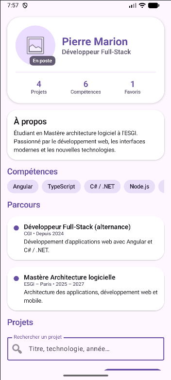
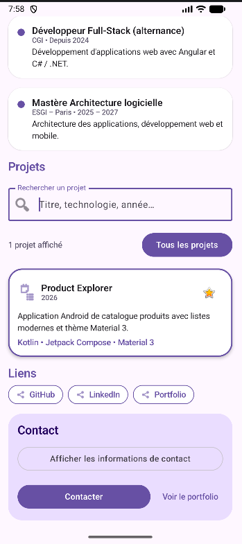

# Profil développeur interactif

Application Android réalisée avec **Kotlin** et **Jetpack Compose** (Material 3), dans le cadre du Bloc 3 : gestion de l'état.

## 1. Description

L'application présente le profil d'un développeur (en-tête, à propos, compétences, parcours, projets, liens et contact). Dans cette version, elle devient un petit portfolio interactif. L'utilisateur peut :

- **rechercher un projet** par son titre, une technologie, un mot de la description ou l'année ;
- **ajouter ou retirer un projet des favoris** avec l'étoile de chaque carte (un projet favori a aussi une bordure colorée) ;
- **afficher uniquement les projets favoris**, ou à nouveau tous les projets ;
- voir **le nombre de projets affichés**, qui change avec la recherche et le filtre (« 1 projet affiché », « 3 projets affichés », « Aucun projet affiché ») ;
- **afficher ou masquer les informations de contact** ;
- ouvrir les liens (GitHub, LinkedIn, portfolio) et l'application mail.

Les données restent locales (`sampleProfile()`).

## 2. États gérés par l'application

État principal, géré par le `ProfileViewModel` dans `ProfileUiState` :

| État | Type | Rôle |
|---|---|---|
| `profile` | `DeveloperProfileUi` | Les données du profil |
| `searchQuery` | `String` | Le texte de recherche |
| `showOnlyFavorites` | `Boolean` | Le filtre « favoris uniquement » |
| `favoriteProjectIds` | `Set<Int>` | Les identifiants des projets favoris |
| `visibleProjects` | `List<ProjectUi>` | La liste des projets réellement affichés |

État local, dans le composable `ContactSection` :

| État | Type | Rôle |
|---|---|---|
| `showContactDetails` | `Boolean` | Affiche ou masque les informations de contact |

## 3. État local

> **Quel état avez-vous conservé directement dans un composable et pourquoi ?**

J'ai gardé `showContactDetails` dans `ContactSection`, avec `rememberSaveable { mutableStateOf(false) }`.

C'est un simple état d'affichage. Il ne concerne que cette section, aucune autre partie de l'écran n'en a besoin, et il n'a rien à voir avec les données ou la logique de l'application. Le mettre dans le ViewModel aurait alourdi l'état principal pour rien. J'ai choisi `rememberSaveable` plutôt que `remember` pour que la section reste ouverte quand on tourne l'écran.

## 4. State Hoisting

> **Pourquoi votre composable d'écran principal peut-il être considéré comme stateless ?**

`ProfileScreen` ne stocke aucun état principal. Il ne contient ni `remember` ni `mutableStateOf`, et il ne connaît pas le ViewModel. Il reçoit :

- toutes les **valeurs** à afficher en paramètres (`profile`, `visibleProjects`, `searchQuery`, `showOnlyFavorites`, `favoriteProjectIds`) ;
- toutes les **actions** de l'utilisateur sous forme de **callbacks** (`onSearchQueryChange`, `onToggleFavoriteFilter`, `onFavoriteClick`, etc.).

Quand l'utilisateur tape du texte ou touche une étoile, l'écran ne modifie rien lui-même. Il prévient son parent en appelant le callback. L'état a donc été « remonté » (hoisted) vers le ViewModel. Grâce à ça, l'écran est facile à réutiliser et à afficher dans les previews avec n'importe quel état.

## 5. ViewModel

> **Quel est le rôle de votre ViewModel dans cette application ?**

`ProfileViewModel` est le **propriétaire de l'état principal** de l'écran. Il :

- garde l'état dans un `MutableStateFlow<ProfileUiState>` **privé** ;
- expose cet état en lecture seule (`uiState: StateFlow<ProfileUiState>`) ;
- propose les actions `onSearchQueryChange`, `onToggleFavoriteFilter` et `onFavoriteClick` ;
- recalcule la liste `visibleProjects` après chaque action, dans une seule fonction `updateState()`. La liste affichée est donc toujours cohérente avec la recherche, le filtre et les favoris.

Le ViewModel ne dépend d'aucun composant Compose. Il survit aussi aux changements de configuration, comme une rotation : la recherche et les favoris ne sont pas perdus.

## 6. StateFlow

> **Comment l'interface est-elle informée lorsqu'un état change ?**

Le `StateFlow` contient toujours **la dernière valeur** de l'état. Dans `ProfileContainer`, `viewModel.uiState.collectAsState()` transforme ce flux en état Compose et l'observe.

Le déroulement est le suivant :

1. L'utilisateur fait une action, par exemple toucher une étoile.
2. L'écran appelle le callback, qui appelle `viewModel.onFavoriteClick(id)`.
3. Le ViewModel crée un **nouvel** `ProfileUiState` avec `copy()` et le publie dans le `StateFlow`.
4. `collectAsState()` reçoit cette nouvelle valeur, et Compose **recompose** les composables qui l'utilisent.
5. L'interface affiche le nouvel état : l'étoile est remplie, le compteur et la liste sont mis à jour.

```
ProfileViewModel  --(publie un état)-->  ProfileContainer  --(valeurs)-->  ProfileScreen
       ^                                                                       |
       |----------------------------(événements / callbacks)------------------|
```

## 7. Organisation du code

| Fichier / élément | Rôle |
|---|---|
| `ProfileUiState.kt` → `ProfileUiState` | Regroupe l'état principal de l'écran |
| `ProfileUiState.kt` → `filterProjects()` | Fonction de filtrage (recherche + favoris), utilisée par le ViewModel et les previews |
| `ProfileViewModel.kt` → `ProfileViewModel` | Gère l'état principal et les actions, expose un `StateFlow` |
| `MainActivity.kt` → `ProfileContainer` | Récupère le ViewModel, collecte le `StateFlow` et passe valeurs et callbacks à l'écran |
| `MainActivity.kt` → `ProfileScreen` | Écran principal **stateless** |
| `ProjectSearchField` | Champ de recherche, avec un bouton pour effacer |
| `ProjectFilterRow` | Compteur de projets affichés et bouton « Favoris uniquement / Tous les projets » |
| `ProjectCard` + `FavoriteButton` | Carte d'un projet avec l'étoile favori |
| `EmptyProjectsMessage` | Message quand aucun projet ne correspond |
| `ContactSection` | Section contact, avec l'**état local** `showContactDetails` |
| `ProfileHeaderCard`, `SkillsSection`, `ExperienceItem`, `LinksSection`… | Composables réutilisables de l'affichage du profil |
| `ui/theme/` | Couleurs, typographie et formes Material 3 |

## 8. Previews

Les previews utilisent directement `ProfileScreen` (stateless), sans ViewModel :

1. **Recherche vide, aucun favori**, en thème clair : tous les projets sont affichés.
2. **Recherche « kotlin » + favoris uniquement**, en thème sombre : plusieurs favoris, 2 projets affichés.
3. **Recherche sans résultat** : message « Aucun projet ne correspond ».
4. **Profil junior disponible**.
5. **Section contact ouverte** (état local à `true`).

## 9. Capture d'écran


