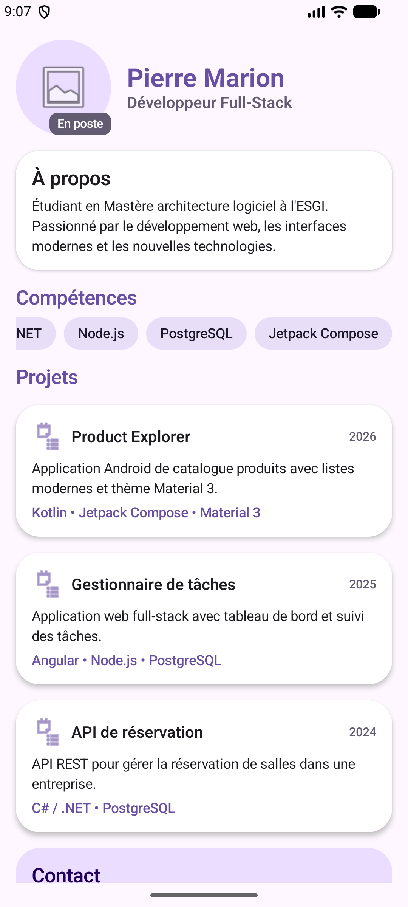
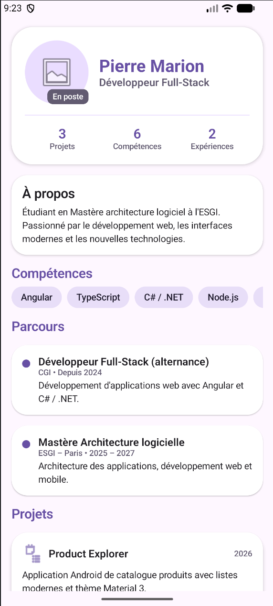

# Profil développeur – version améliorée

Application Android en Jetpack Compose qui affiche mon profil de développeur.

> Projet réalisé avec l'aide d'une IA (Claude), dans le cadre d'un exercice d'entraînement.

## Description

C'est la suite de ma première fiche « Profil développeur » (autre dépôt). J'ai repris l'appli pour la rendre plus complète et plus propre avec ce qu'on a vu dans le chapitre Compose UI.

L'écran affiche mon nom et mon rôle avec un avatar, une description, mes compétences, quelques projets et une zone de contact avec un bouton « Contacter ». Les données sont écrites directement dans le code (`sampleProfile()`), il n'y a pas d'API ni de base de données.

## Capture d'écran

## Composants utilisés

- `Text` : nom, rôle, titres, descriptions
- `Button` : bouton « Contacter »
- `Icon` : icônes des projets et de la zone contact
- `Image` : avatar (image placeholder découpée en cercle)
- `Card` : bloc « À propos » et cartes des projets
- `OutlinedTextField` en lecture seule : affichage de l'email
- `Surface` : badge de dispo, pastilles de compétences, zone contact

## Layouts utilisés

- `Column` pour empiler les éléments à l'intérieur des cartes
- `Row` pour mettre l'avatar à côté du nom, et pour les lignes d'infos du contact
- `Box` pour poser le badge « En poste / Dispo » sur l'avatar
- `Spacer` pour les espaces
- `Surface` pour la zone de contact

## Les listes

Tout l'écran est une `LazyColumn` (`ProfileScreen`). Les blocs uniques (en-tête, description, contact) sont ajoutés avec `item`, et les projets avec `items(profile.projects, key = { it.id })`. Chaque projet est affiché par le composable `ProjectCard`.

Les compétences sont dans une `LazyRow` (`SkillsSection`), qui défile horizontalement. Chaque compétence est affichée avec `SkillChip`.

## Le thème

J'ai choisi une couleur violette. Le thème est dans `Theme.kt` et `Type.kt` :

- deux palettes : violet foncé sur fond clair en mode clair, violet clair sur fond sombre en mode sombre, pour que ça reste lisible
- j'ai enlevé les couleurs dynamiques (Material You) pour que l'appli garde toujours le violet
- une typo perso (`ProfileTypography`) : nom en gros et en gras, titres de section un peu plus petits, texte normal pour le reste
- des formes arrondies (`ProfileShapes`) utilisées pour les cartes, les pastilles et le badge
- les composants utilisent seulement `MaterialTheme.colorScheme`, donc tout change tout seul entre le mode clair et le mode sombre

Il y a 3 previews : thème clair, thème sombre, et un deuxième profil (développeur Android junior disponible pour un stage).

## Quelles notions du chapitre Compose UI ai-je réutilisées ?

Les composants de base (Text, Button, Icon, Image, Card, OutlinedTextField), les layouts (Column, Row, Box, Spacer, Surface), les listes avec LazyColumn et LazyRow et des cartes réutilisables, et le thème Material 3 (couleurs, typo, formes, clair et sombre). J'ai aussi gardé ce que j'avais fait dans le premier devoir : des petits composables avec des paramètres, un `modifier` sur chacun, des callbacks pour les clics, l'accessibilité et les previews.
